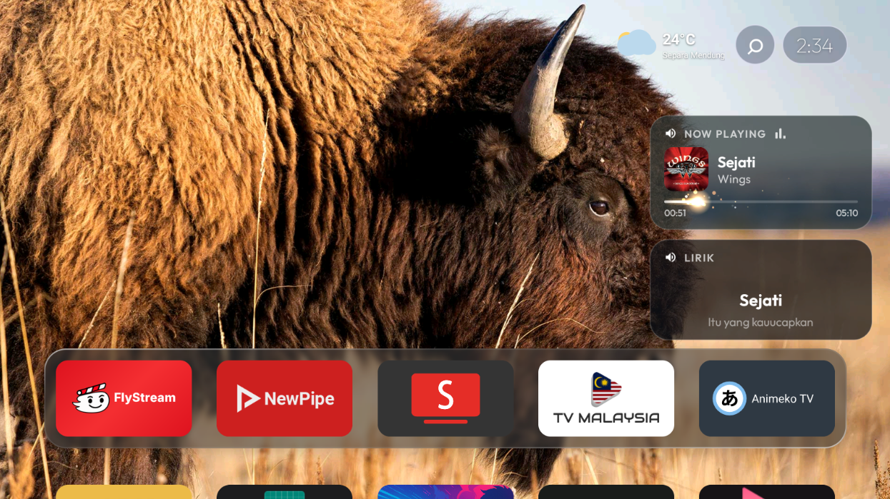
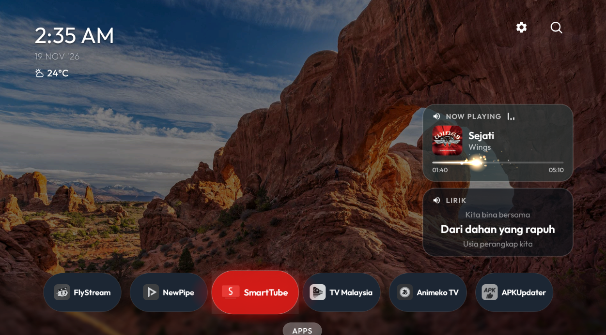
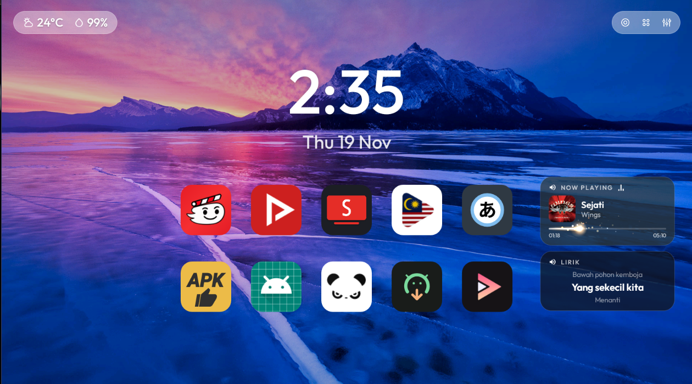
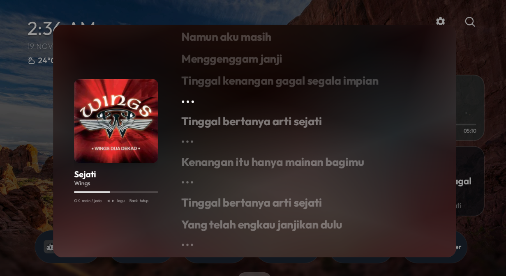
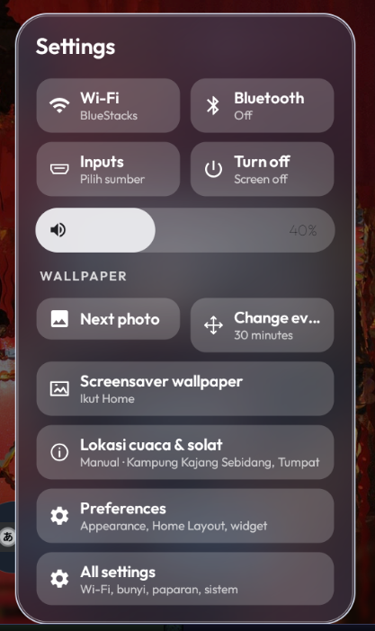
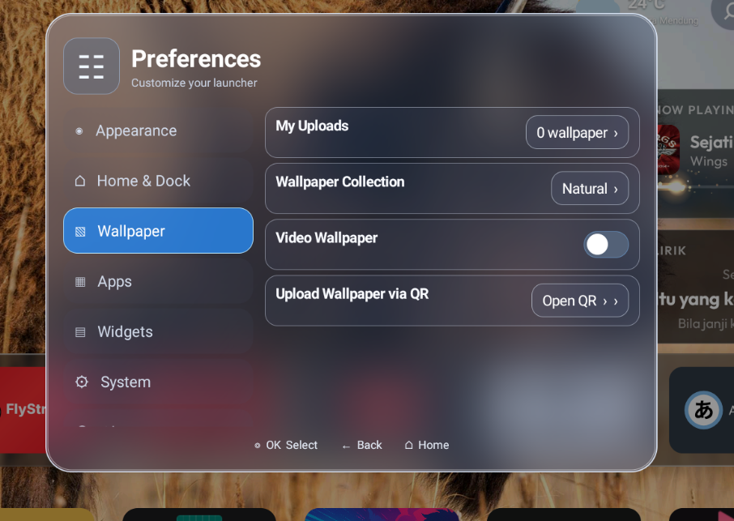
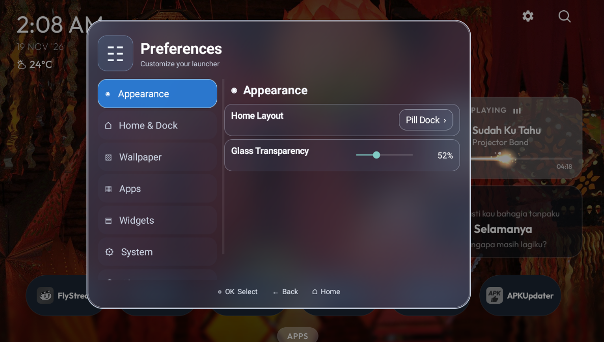

# Glass TV CHOMBB

Launcher untuk **Android TV, Google TV dan TV Box** dengan empat susun atur Home, dock kaca, widget muzik dan kawalan D-pad. Tukar rupa Home terus dari Quick Settings.

**Versi OTA semasa ialah v3.3.7, kod 51.** [Muat turun APK](https://github.com/chombeee/tv-g/releases/download/v3.3.7/v3.3.7.apk) · [Nota keluaran dan ZIP sumber](https://github.com/chombeee/tv-g/releases/tag/v3.3.7)

Perlu **Android 8.0 (API 26)** atau lebih baharu. Selepas memasang APK, pilih Glass TV sebagai launcher Home jika TV menawarkan pilihan itu.

## Paparan Home

| Susun atur | Rupa dan penggunaan |
| --- | --- |
| **Classic** | Dock kaca dengan kad aplikasi lebar dan grid di bawahnya. |
| **Hero** | Jam besar di tengah, grid ikon dan widget di sebelah kanan. |
| **Pill** | Barisan aplikasi berbentuk kapsul di atas gradient blur, dengan pintasan **Apps** ke semua aplikasi. |
| **Material** | Dock dan panel berpalet dinamik. |

Buka **Quick Settings → UI Seterusnya** untuk menukar layout mengikut turutan Classic → Hero → Pill → Material. Untuk memilih terus, buka **Preferences → Appearance → Home Layout**.

| Classic | Pill |
| :---: | :---: |
|  |  |



## Muzik, lirik dan widget

- **Now Playing** memaparkan tajuk, artis, kulit album dan masa lagu daripada aplikasi muzik yang aktif. Pilih bar **Api** atau **Kepala bercahaya** dalam **Preferences → Widgets → Now Playing Bar**.
- **Lirik** tersedia sebagai kad Home dan paparan besar. Pilih **Api**, **Emas**, **Neon** atau **Ombak** dalam **Preferences → Widgets → Gaya Lirik**. Api memercik seperti bar Now Playing, manakala Ombak menyapu huruf dengan percikan air. Lirik bergerak mengikut lagu apabila cap masa tersedia.
- **Widget lain** termasuk Recent Apps, waktu solat dan kalendar. Laraskan saiz dan susunan widget dalam **Preferences → Widgets**.

| Lirik pada paparan besar | Quick Settings |
| :---: | :---: |
|  |  |

### Kawalan remote

| Tindakan | Hasil |
| --- | --- |
| **OK** pada aplikasi | Buka aplikasi. |
| **Tahan OK** pada aplikasi | Buka menu tindakan seperti Move, App info atau Sorok, mengikut item. |
| **Atas/Bawah** pada Home | Bergerak antara Settings, widget dan aplikasi. Dalam Hero, **Kanan** dari hujung grid masuk ke widget dan **Kiri** dari lajur widget paling kiri kembali ke grid. |
| **OK** pada Now Playing | Buka aplikasi muzik yang sedang bermain. |
| **Tahan OK** atau **Menu** pada Now Playing | Simpan atau Like lagu jika aplikasi muzik menawarkan tindakan itu. |
| **OK** pada kad Lirik | Buka paparan lirik besar. Tekan **OK** untuk main/jeda, **Kiri/Kanan** untuk menukar lagu, atau **Back/Home** untuk menutup paparan. |

## Quick Settings dan Preferences

- **Quick Settings** menghimpunkan Wi-Fi, Bluetooth, Inputs, Turn off, Volume dan Wallpaper dalam satu panel. Pada v3.3.7, Wi-Fi/Bluetooth, Inputs/Turn off dan pilihan foto kembali berpasangan. **UI Seterusnya** berada di bawah **All settings**.
- **Wallpaper** boleh dipilih daripada koleksi, ditukar kepada video, atau dihantar dari telefon. Buka **Preferences → Wallpaper → Upload Wallpaper via QR**, imbas kod QR pada rangkaian Wi-Fi yang sama, dan biarkan skrin QR terbuka sehingga muat naik selesai.
- **System** menyediakan pilihan cuaca Malaysia, stesen jerebu JAS/APIMS, lokasi waktu solat JAKIM serta pintasan Wi-Fi. **About** menyediakan **Check for Updates**, tutorial kebenaran, Backup & Restore dan Crash Log.

| Wallpaper | Appearance |
| :---: | :---: |
|  |  |

## Pasang dan tetapkan sebagai Home

Muat turun `v3.3.7.apk` daripada halaman release. Pasang fail pada TV dengan pengurus fail atau sambungkan PC menggunakan Android Platform Tools. Jika TV menggunakan Wireless debugging, gunakan alamat dan port yang dipaparkan oleh TV untuk pairing dan sambungan. [Android Platform Tools](https://developer.android.com/tools/releases/platform-tools)

```bash
adb devices
adb install -r v3.3.7.apk
```

Jika menggunakan telefon Android dengan Termux, jalankan `pkg install android-tools`, benarkan akses fail dengan `termux-setup-storage`, kemudian gunakan `adb install -r ~/storage/downloads/v3.3.7.apk` selepas menyambung ke TV.

Jika pilihan launcher Home tiada dalam Settings TV, pilih arahan ADB yang sepadan dengan versi peranti. Sokongan bergantung pada firmware.

**Android 10 dan ke atas**

```bash
adb shell cmd role add-role-holder --user 0 android.app.role.HOME com.faris.glasstv
```

**Android TV 9**

```bash
adb shell cmd package set-home-activity com.faris.glasstv/com.gathin.tvhome.MainActivity
```

Tekan **Home** untuk semak hasilnya. Untuk Now Playing dan lirik, pergi ke **Preferences → Widgets → Notification Access** dan benarkan Glass TV. Jika TV gagal membuka skrin kebenaran itu, cuba arahan ini.

```bash
adb shell cmd notification allow_listener com.faris.glasstv/com.gathin.tvhome.ChombbMediaListener
```

## Kemas kini dan bina sendiri

**Pada TV**, buka **Preferences → About → Check for Updates**. Jika pemasangan kemas kini ditolak kerana tandatangan berbeza, bina APK dengan **keystore yang sama** seperti pemasangan lama untuk mengekalkan data dan tetapan.

**Pada Windows**, ekstrak ZIP sumber v3.3.7, pasang JDK 17 dan Android SDK Platform 34, kemudian jalankan `Build-v3.3.7.cmd`. APK keluar dalam `GlassTV-work\app\build\outputs\apk\release`. Gunakan ZIP sumber pada halaman release untuk membina versi yang sepadan dengan APK v3.3.7. [ZIP sumber v3.3.7](https://github.com/chombeee/tv-g/releases/download/v3.3.7/GlassTV-v3.3.7.zip)

### Terbitkan OTA GitHub

1. Naikkan `versionCode` dalam `app/build.gradle` melebihi kod release OTA semasa. Tetapkan `versionName` untuk keluaran baharu.
2. Bina dengan keystore asal. Cipta release dan muat naik APK yang sepadan dengan tag.
3. Selepas sahkan APK boleh dimuat turun, kemas kini `release/version.json` pada branch `main`. Nilai `versionCode` dan `versionName` mesti sepadan dengan APK. Gunakan URL aset release untuk `apkUrl`. [Manifest OTA](release/version.json)

## Kredit

Terima kasih kepada **Gathin** untuk projek asal **CleanYourTV** dan **aqmangge** untuk **Glass TV**. Fon **Outfit** menggunakan SIL Open Font License. Logo aplikasi, gambar dan kandungan muzik milik pemilik masing-masing. [Lesen fon](FONT-LICENSE-OFL.txt)
